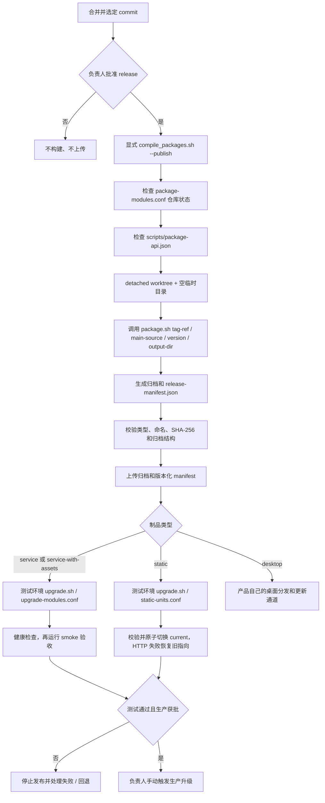

# 社区项目打包规范

## 目标

统一社区项目的构建输入、制品身份、校验和部署边界。规范针对“可部署单元”而不是 Git 仓库：一个仓库可以产出多个能独立发布或回滚的单元；多个进程若必须作为同一版本协同运行，则组成一个服务单元。

打包/发布和部署/升级是两个不同动作：显式发布流程构建并上传不可变制品；环境升级流程只读取已发布制品。测试环境可以定时检查新制品，生产升级必须由人工审批触发。代码提交本身不得触发定时打包或自动上传。

## “安全 package API”是什么意思

这里的 API 是 `scripts/package.sh` 的**命令行接口约定**，不是 Web API、HTTP API，也不是要调用的新服务。项目脚本接收固定的 `--ref`、`--version`、`--output-dir` 参数，并按约定输出归档和 `release-manifest.json`。这样发布器不用为每个仓库维护不同的调用方式。

`scripts/package-api.json` 是这份接口的机器可读声明，每个源码仓库一份；它不是打包脚本，也不是某次构建的制品清单。发布器在运行项目脚本前先读取它，确认脚本声明了所需参数、不会创建或推送 Git tag，并承诺按隔离 checkout 和 manifest 契约工作。检查不通过时，发布器拒绝调用旧脚本，避免继续使用过去可能 fetch、切分支、写 tag 或清理工作区的入口。

虽然当前各仓库的文件内容相同，仍将声明放在每个项目里，因为它是该项目**明确接入统一发布器的版本化声明**：声明与 `package.sh` 随同一个源码 commit 审查、发布和回滚，发布器可以针对准备构建的项目版本预检契约；新仓库没有声明时也会被拒绝发布。若改成只在 deployer 维护中央列表，项目脚本与声明会分开演进，中央列表还需额外追踪每个仓库的版本和例外。若通过运行 `package.sh --help` 发现能力，又必须先执行项目代码才能判断它是否符合安全契约。当前 JSON 不是重复的项目构建配置，而是轻量的逐仓库 opt-in 和兼容性检查点。

两份文件解决不同问题：

| 文件 | 记录什么 | 什么时候使用 |
| --- | --- | --- |
| `scripts/package-api.json` | 仓库打包脚本支持的调用方式和副作用边界；随源码维护 | 发布器在执行 `package.sh` 前读取 |
| 构建输出 `release-manifest.json` | 本次构建实际生成的 unit、类型、版本、commit、归档名和 SHA-256 | 发布器校验、上传；部署器据此识别静态单元 |

保留 JSON 声明文件，是为了让发布器在不先运行任意项目代码的情况下统一检查接口，再用 `jq` 读取少量固定字段；`jq` 是发布/打包环境的工具依赖，不是产品运行时依赖，也不要求项目用 JSON 或特定编程语言实现打包脚本。改成 Shell 并不意味着删掉这份声明：Shell 脚本负责执行构建，JSON 负责声明发布器可以安全调用的契约。

这份 JSON 本身不是沙箱，也不能证明脚本没有隐藏副作用。真正的边界还包括发布器在 detached worktree 中运行脚本、使用独立临时输出目录、验证结果，并对脚本实现进行代码审查。项目不得仅靠填写 `false` 或 `true` 来代替遵守这些要求。

## 术语与交付类型

| 类型 | 用途 | 运行约定 |
| --- | --- | --- |
| `service` | 一个后端或长运行服务 | 包内必须有 `scripts/starter.sh`、`scripts/health-check.sh`、`scripts/test.sh` |
| `service-with-assets` | 与一组前端资源强耦合、必须同版本部署的服务 | 同时包含服务运行文件和静态资源；资源不可独立回滚 |
| `static` | 一个网站或可独立发布的静态资源集 | 不需要后台进程或 `starter.sh`；声明站点 ID、统一部署目录和静态健康检查路径 |
| `desktop` | 桌面安装程序或更新包 | 不进入服务节点的统一升级清单；按桌面应用发布流程分发 |

项目必须提供仓库根目录下的 `scripts/package.sh`。纯文档仓库及桌面应用可以没有服务启动脚本；每个实际运行的服务单元都必须提供 `scripts/starter.sh`。不要为了满足脚本数量而把纯静态内容包装成空服务。

## 发布输入和副作用

受控发布入口调用：

```bash
operator/upgrade/compile_packages.sh --publish [--bump patch|minor|major]
```

构建器再以选定的 commit 调用项目脚本：

```bash
scripts/package.sh --ref <tag-commit-sha> --source-commit <main-commit-sha> --version <major.minor.patch> --output-dir <directory>
```

为防止旧脚本被误调用，项目还必须提供 `scripts/package-api.json`，声明兼容的 API 和无副作用能力：

```json
{
  "api_version": 1,
  "supports": ["--ref", "--source-commit", "--version", "--output-dir"],
  "creates_git_tags": false,
  "pushes_git_refs": false,
  "builds_in_isolated_checkout": true,
  "manifest": "release-manifest.json"
}
```

`api_version: 1` 表示遵循本文件定义的 v1 命令行接口；`supports` 列出必须接受的参数；`creates_git_tags`、`pushes_git_refs` 和 `builds_in_isolated_checkout` 声明发布副作用边界；`manifest` 是构建结果的文件名。发布器会拒绝缺文件、缺字段、字段值不符或不支持必需参数的仓库。

### `package-api.json` 字段逐项说明

当前 12 个仓库的 `scripts/package-api.json` 内容完全一致。项目之间的构建命令、依赖和交付单元可以不同；这些差异由各自的 `scripts/package.sh` 实现以及本次构建生成的 `release-manifest.json` 表达，不通过修改这份通用接口声明来表达。

| 字段 | 类型与当前约束 | 具体含义及发布器行为 |
| --- | --- | --- |
| `api_version` | JSON 数值，当前必须等于 `1` | 打包脚本命令行契约的版本，不是制品版本。发布器当前只认识 v1；缺失或写成其他值时会拒绝运行脚本。若以后要改参数兼容性，必须先定义并部署新版调用契约，再迁移项目。 |
| `supports` | 字符串数组，必须包含 `--ref`、`--source-commit`、`--version`、`--output-dir` | 声明脚本接受的选项名。发布器逐次调用时会传入这四个公共选项；数组顺序无关。当前校验器允许列出额外字符串，但发布器不会自动使用项目私有选项；新增选项前应先更新公共契约及调用器，避免只有声明而无人传参。 |
| `creates_git_tags` | 布尔值，必须为 `false` | 脚本不能创建 Git tag。版本由受控发布流程传入，打包脚本只负责构建制品；若声明为 `true`，发布器拒绝调用。 |
| `pushes_git_refs` | 布尔值，必须为 `false` | 脚本不能推送分支、tag 或其他 Git ref。发布器不会允许构建步骤顺带改写远端仓库；若声明为 `true`，发布器拒绝调用。 |
| `builds_in_isolated_checkout` | 布尔值，必须为 `true` | 声明脚本能在发布器提供的 detached worktree/隔离 checkout 中工作，不依赖开发者当前分支、未提交文件或原工作区状态。发布器负责创建隔离 checkout；这个字段是项目对兼容性的声明，不是沙箱，也不能单独证明脚本没有副作用。 |
| `manifest` | 字符串，当前必须精确为 `release-manifest.json` | 指定 `--output-dir` 根目录下本次构建清单的固定文件名。发布器会读取并校验该清单，再校验清单列出的归档及 SHA-256；不能把仓库级 `package-api.json` 当成某次构建的制品清单。 |

四个 `supports` 选项的参数含义也固定：`--ref` 是 tag 对应的 release commit，脚本必须从该 commit 取源码；`--source-commit` 是 tag 所记录的社区 `main` 源码 commit，必须是 `--ref` 的祖先，用于制品命名和 manifest 溯源；脚本不能自行 fetch 或改切调用方工作区。`--version` 是 `major.minor.patch` 格式的制品版本，不带 `v` 前缀；`--output-dir` 是发布器提供的空输出目录，脚本在其中写归档和 manifest，不能删除或清理调用者传入的目录。字段检查只确认声明符合 v1，仍需结合脚本审查和实际构建验证。

### 项目如何配置

新项目接入时，在仓库的 `scripts/` 下创建 `package-api.json`，复制上面的 v1 模板并保留这些固定值。当前没有按 `service`、`static`、`desktop` 或项目语言调整这些字段的情况，也不需要在文件里填仓库名、unit ID、版本号、依赖命令或部署路径；这些属于 `package.sh` 输入/实现或 `release-manifest.json` 的内容。现有 12 个项目都使用同一份 JSON。

同时确认项目的 `scripts/package.sh` 实际接受并遵守声明的四个参数，通常通过共享参数解析逻辑处理。特别是 `builds_in_isolated_checkout: true` 要求脚本可以在发布器创建的 detached worktree 中运行；脚本不负责创建该 worktree，也不能假设原开发工作区、当前分支或未提交文件存在。字段是项目维护者对兼容性的承诺，只有审查实现并通过构建验证后才应保留 `true`。

提交前可以用发布器同一套规则预检 JSON：

```bash
jq -e '
  type == "object" and
  .api_version == 1 and
  (.supports | type == "array" and all(.[]; type == "string") and
    (["--ref", "--source-commit", "--version", "--output-dir"] - . == [])) and
  .creates_git_tags == false and
  .pushes_git_refs == false and
  .builds_in_isolated_checkout == true and
  .manifest == "release-manifest.json"
' scripts/package-api.json
```

输出 `true` 只表示声明满足当前 v1 检查。接入验收还应从干净 checkout 选一个已提交 commit，实际运行 `scripts/package.sh --ref "$PACKAGE_REF" --source-commit "$PACKAGE_SOURCE_COMMIT" --version 1.2.3 --output-dir "$PACKAGE_OUTPUT"`，然后验证输出 manifest、归档与 SHA-256。不要仅为让预检通过而填写布尔值。

#### 后续扩展规则

这份文件为将来的跨项目能力扩展留有位置，但“有 JSON 文件”不代表未来字段会自动生效。当前发布器只检查上表列出的 v1 字段；额外的顶层字段会被忽略，`supports` 中额外列出的参数也不会被发布器调用。需要新增能力时，先更新本规范、发布器校验和调用行为，再迁移各项目声明；向后兼容的可选能力要确认旧版发布器能安全忽略，改变必需参数或字段语义时则须提升 `api_version` 并先部署支持新版的发布器。不要为了假设中的项目差异提前加入各自私有字段。

- `--ref` 必须解析为确定的 Git commit；正式制品只允许从已提交代码构建，工作区中未提交或未跟踪文件不得进入制品。
- `--version` 使用 `major.minor.patch`，不含 `v` 前缀。打包脚本不得自行 fetch/switch 调用方工作区、创建或推送 Git tag、上传制品、部署服务，也不得清理调用者的输出目录。
- 构建器在隔离的 detached worktree/checkout 中准备源码，并在完成后移除该临时目录；不得对持久项目目录执行 `git reset --hard` 或 `git clean -fd`。
- 如果引用、版本、依赖安装或构建失败，脚本必须非零退出，不得留下看似有效的半成品包。
- 生产依赖应由项目提交的锁文件确定安装版本，例如 `pnpm install --frozen-lockfile`、`composer install --no-dev --prefer-dist`。项目明确选择不跟踪 npm `package-lock.json` 时，打包使用 `npm install`；此方式会按当时 registry 可解析的版本安装依赖，构建结果可能随时间变化。
- 每个构建都应校验工具版本和必需资源，输出可读错误。对提交锁文件的生态使用锁定安装方式；不跟踪 npm 锁文件的项目可使用 `npm install`，本地生成的 `package-lock.json` 不进入版本控制或发布包。

`operator/upgrade/compile_packages.sh` 是显式发布入口。必须通过 `--publish` 人工或由明确的受控发布事件触发；无参数调用只报告自动打包已停用并成功退出。CI 若调用它，必须绑定已批准的 release 事件，而非普通 push、定时扫描或文件变更检测。发布入口运行期间持有锁，构建、校验和上传任一步失败都应返回非零。

### Git tag 何时创建

每个社区仓库的 `scripts/tag.sh` 在显式打包时计算下一个 patch/minor/major 版本，并在临时 detached worktree 中更新 `version-files.conf` 指定的版本文件，创建只用于该版本的 release commit 和 annotated tag。它只推送 tag，不推送或改写 `main`。因此版本文件用于记录 tag 对应的源码版本，不要求提交回 `main`；社区 `main` 保持日常开发状态。

tag 的父提交是打包时已同步的社区 `main` 最新 commit。tag 信息记录 `Source-Commit`，指向该 `main` commit。编译器从 tag commit 的源码构建，以 tag 名作为制品版本，同时以 `Source-Commit` 生成包名后缀和 manifest 的 `source_commit`。例如 `main` commit 为 `abc1234`、tag 为 `v0.0.162` 时，包名为 `router-v0.0.162-abc1234.tar.gz`。tag commit 可额外包含版本文件变更，但不会改变包名中的 main commit ID。

打包机只允许从干净且与社区 `origin/main` 一致的 `main` 发布；tag 的 source commit 必须是远端 `main` 的祖先。GitHub 对 `main` 的 PR、review 和 required checks 规则保持不变；发布机没有绕过分支保护的权限。仓库也应对 `v*` tag 使用受控规则，限制只有获准的发布身份可以创建 tag，并禁止移动或删除已发布 tag。

一个仓库默认所有制品使用 tag 的同一版本。若要单独设置制品版本，在 `scripts/artifact-versions.conf` 中按 `unit-id MAJOR.MINOR.PATCH` 配置；tag commit 会包含该映射变更，打包器和 manifest 按每个 unit 的版本命名。各项目通过 `scripts/version-files.conf` 列出需要同步更新 `.version` 字段的 JSON 版本文件。

若构建或上传失败，保留已创建的不可变 tag，使用 `compile_packages.sh --publish --tag 仓库:v版本` 重建同一 tag。显式重建时，编译器会读取 tag 中的 `Source-Commit`（旧 tag 缺少该字段时读取 tag commit 的父提交），验证其仍在社区 `main` 历史中，再按 tag 版本构建。不要再次默认递增版本来重试同一发布，也不要移动或覆盖 tag。

示例：在打包节点的社区仓库检出中执行：

```bash
cd /root/code/deployer/operator/upgrade
./compile_packages.sh --publish
./compile_packages.sh --publish --bump minor
# 已创建 tag 的构建失败后，按同一 tag 重试：
./compile_packages.sh --publish --tag router:v0.0.162
```

`creates_git_tags: false` 和 `pushes_git_refs: false` 仍约束项目 `scripts/package.sh`；tag 创建和推送只由独立的 `scripts/tag.sh` 完成。项目打包 API 同时接收 `--ref`（tag commit）和 `--source-commit`（main commit），分别用于构建源码与制品身份。
## 制品命名和清单

每个可发布单元单独生成一个包，命名格式为：

```text
<unit-id>-v<major>.<minor>.<patch>-<7-char-commit>.tar.gz
<unit-id>-v<major>.<minor>.<patch>-<7-char-commit>.zip  # desktop
```

服务和静态制品使用 tar.gz；desktop 制品可保留平台分发所需的 ZIP 格式。`unit-id` 使用小写字母、数字和连字符；必须在所有项目间唯一。包名中的版本和短 commit 必须与制品清单一致。不可变发布禁止用相同 unit、版本和 commit 覆盖已有的不同字节内容。

`scripts/package.sh` 在输出目录写入 `release-manifest.json`，一次构建可以列出多个可独立发布的制品：

```json
{
  "schema_version": 1,
  "repository": "homepage",
  "source_commit": "0123456789abcdef0123456789abcdef01234567",
  "artifacts": [
    {
      "unit_id": "homepage-yeying",
      "type": "static",
      "version": "1.2.3",
      "package": "homepage-yeying-v1.2.3-0123456.tar.gz",
      "sha256": "<64 lowercase hexadecimal characters>",
      "package_root": "homepage-yeying-v1.2.3-0123456",
      "static_targets": [
        {
          "site_id": "homepage-yeying",
          "path": "/opt/deploy/static/homepage-yeying",
          "health_check_path": "/index.html"
        }
      ]
    }
  ]
}
```

清单约束：

- `source_commit` 必须是 40 位 Git commit SHA；制品文件名中的短 SHA 必须是它的前 7 位。
- `type` 仅接受 `service`、`service-with-assets`、`static`、`desktop`。统一服务器升级器拒绝 `desktop`。
- `package` 必须是输出目录内的单个文件名，禁止绝对路径、`..` 或符号链接逃逸；`package_root` 必须是压缩包内唯一顶层目录。
- `sha256` 是整个 tarball 的 SHA-256。升级器下载后必须验证后才解压。
- `service` 和 `service-with-assets` 必须声明 `starter.sh`、`health-check.sh`、`test.sh` 入口；实际文件必须存在于包内。`static` 必须声明至少一个全社区唯一的 `site_id`、标准部署目录 `/opt/deploy/static/<site_id>` 和包内存在的静态健康检查入口；建议将仓库名作为前缀（如 `homepage-yeying`）。同一 manifest 不得让多个 artifact 使用同一 `site_id`。`path` 必须由部署器按 `site_id` 校验，禁止项目自定义任意目标路径。
- 每个 `unit_id` 在一个 manifest 内最多出现一次。升级器必须分别比较每个 unit 的当前版本，某个 unit 失败不应把其他 unit 的结果伪装为成功。
- manifest 和它列出的所有制品一起上传；不得只发布包而遗漏校验清单。

deployer 的发布端校验器为 `operator/upgrade/package_manifest.sh`，使用 POSIX shell、`jq`、`tar` 和 `sha256sum`（或 `shasum`）；校验 release manifest 不需要 Python 运行时。

## 安装包内容

服务类型安装包至少包含运行二进制/运行代码、运行所需依赖、配置模板和 `scripts/starter.sh`、`scripts/health-check.sh`、`scripts/test.sh`。统一升级接入单元还必须包含实现 `prepare`、`copy-config`、`post-copy`、`finalize` 阶段的 `scripts/upgrade.sh`。服务启动、健康检查和 smoke 测试不得依赖源码 checkout、开发机缓存或未随包交付的构建目录。

独立发布的静态资源统一部署在 `/opt/deploy/static/<site_id>` 下，所有环境使用相同的目录布局：

```text
/opt/deploy/static/<site_id>/
├── current -> releases/<package_root>
└── releases/
    ├── <previous-package_root>/
    └── <package_root>/
```

manifest 的 `static_targets[].path` 固定为 `/opt/deploy/static/<site_id>`，作为站点部署根目录；升级器不接受仓库或 manifest 指定其他绝对路径。Web 服务器的静态 root 统一指向 `/opt/deploy/static/<site_id>/current`。升级器在 `releases/` 中解包并检查目标版本，再原子切换 `current`，保留上一版本供回滚。与后端必须同版本部署的静态资源继续包含在 `service-with-assets` 服务包中，不拆到独立站点目录。

所有项目的 `output/` 必须写入 `.gitignore`。打包产物不能包含凭据、开发环境缓存、`node_modules`（运行时确实需要且经评审的例外除外）、测试私密数据、日志或本地数据库。

## 打包、部署和升级完整流程

### 共同发布步骤

选定已合并到 `main` 的源码 commit；编译器从该 commit 创建版本 tag commit，再按 tag 版本构建。直接调用项目打包接口时，分别传入 tag commit 与 main source commit。

```bash
cd /path/to/deployer/operator/upgrade
./compile_packages.sh --publish
```

发布前，`package-modules.conf` 列出的每个仓库必须位于干净的 `main`。构建器逐仓 fetch `origin/main` 并同步；遇到脏工作区或不受支持的本地分叉时停止，不会清理用户数据。为恢复旧版打包失败留下的状态，只有当本地 `main` 恰好指向一个已打 tag、其唯一父提交是 `origin/main`、且该提交只改动配置声明的版本文件时，脚本才用 `git reset --keep origin/main` 复位本地分支；原版本提交继续由 tag 保留。同步后构建器检查 `scripts/package-api.json`，为选定 commit 创建 detached worktree 和空临时输出目录，再调用：

```bash
bash scripts/package.sh \
  --ref <tag commit SHA> \
  --source-commit <main commit SHA> \
  --version 1.2.3 \
  --output-dir <空临时目录>
```

项目脚本按自身技术栈构建一个或多个 unit，写出归档和 `release-manifest.json`。deployer 检查仓库名、版本、commit、unit 类型、包名、SHA-256、归档根目录和类型要求；全部通过后，上传不可变归档和版本化清单 `release-manifest-<repository>-v<version>-<commit>.json`。失败时返回非零，不能发布半套 manifest 或假装成功。

例如 Homepage 仓库的一次本地打包调用形式是：

```bash
source_commit="$(git rev-parse HEAD)"
tag_commit="$(git rev-parse v1.2.3^{commit})"
mkdir -p output
bash scripts/package.sh --ref "$tag_commit" --source-commit "$source_commit" --version 1.2.3 --output-dir output
```

`output/` 必须为空。它会包含多个以 `unit-id-v1.2.3-<commit>.tar.gz` 命名的 artifact，以及一个 `release-manifest.json`；发布器实际构建时使用临时输出目录，所以不会写入持久工作区。正式 release 必须从干净、已提交的 commit 构建，不能用本地未提交目录代替发布器的隔离构建。



代码 push 和定时扫描都不会构建或上传。测试环境只轮询已上传的制品；生产环境必须先完成测试环境验证，再由负责人批准并手动触发。

### `service`：独立服务

以 `billing` 为例，manifest 中 `unit_id` 为 `billing`、`type` 为 `service`。包内包含服务运行代码、运行依赖、配置模板、starter、health check、smoke test 和纳入统一升级所需的 `scripts/upgrade.sh`。测试环境的 `upgrade-modules.conf` 配置 `billing` 后，执行 `upgrade.sh`；生产环境在测试通过和审批后手动执行同一入口。

当前服务升级器使用兼容的模块包名前缀选择归档，再下载、校验（配置了 `FILE_VERIFY` 时校验 sidecar）、解压到 `/opt/deploy/billing-v...`、执行升级 hook、停止旧服务、迁移配置、启动新服务并运行 `health-check.sh --level all`，成功后更新 `/opt/deploy/billing` 软链接。升级后还应执行：

```bash
cd /opt/deploy/billing
bash scripts/test.sh --suite smoke
```

目前 `upgrade.sh` 不自动调用 `test.sh`，也不自动回退服务。smoke 失败或服务启动/健康检查失败时，运维需按项目已验证的回退步骤恢复旧版本并重新检查；不能把旧版本目录仍存在等同于自动回滚成功。服务升级器尚未按 manifest 选择 service artifact，因此新归档还必须保持和 `upgrade-modules.conf` 一致的 legacy 包名前缀。

完整操作顺序示例：

```text
# 构建节点：加入待构建源码仓库
printf '%s\n' billing >> /path/to/deployer/operator/upgrade/package-modules.conf
cd /path/to/deployer/operator/upgrade
./compile_packages.sh --publish

# 测试部署节点：只填写已经首次安装且有当前版本目录的服务单元
printf '%s\n' billing > /path/to/deployer/operator/upgrade/upgrade-modules.conf
cd /path/to/deployer/operator/upgrade
./upgrade.sh

# 测试通过后，登录 billing 服务节点检查已部署包
cd /opt/deploy/billing
bash scripts/health-check.sh --level all
bash scripts/test.sh --suite smoke

# 生产变更审批通过后，在生产部署节点运行
cd /path/to/deployer/operator/upgrade
./upgrade.sh
```

正常升级时，旧服务被停止、配置迁移后启动新版本；健康检查通过才更新活动软链接。`test.sh` 是其后的验收步骤。若 start、health 或 smoke 失败，按 billing 已验证的人工回退 runbook 恢复旧版本，再运行 health 和 smoke；当前统一服务升级脚本尚未实现自动回滚。`compile_packages.sh` 和 manifest 校验器使用 SHA-256 校验发布归档；当前传统服务下载路径只有配置 `FILE_VERIFY=sha256sum` 才用 `.sha256sum` sidecar 在下载后复验，尚未从 manifest 选择服务并对照其中的 SHA-256。此兼容边界在服务 manifest 升级器实现前必须纳入运维验收。

### `service-with-assets`：后端和前端必须同版本

以 `node` 为例，后端 API 与 web 前端必须一起发布、一起回滚，因此 manifest 中使用一个 `unit_id: node`、`type: service-with-assets`，单个归档包含两者。`package-modules.conf` 配置源码仓库 `node`；通过准入验收后，测试和生产的服务升级名单 `upgrade-modules.conf` 也配置 `node`。升级步骤与 `service` 相同，前端随服务包一起启停和回退，不能拆成独立 static unit。

```text
# package-modules.conf
node

# 测试/生产节点 upgrade-modules.conf（前提：该服务已按模块名首次部署）
node

# 构建并发布
cd /path/to/deployer/operator/upgrade
./compile_packages.sh --publish

# 环境升级
./upgrade.sh

# 验收新版本的 API 和 web 组合服务
cd /opt/deploy/node
bash scripts/health-check.sh --level all
bash scripts/test.sh --suite smoke
```

这只产生并部署一个 `node` unit。manifest 中的类型是 `service-with-assets`，但现有 `upgrade-modules.conf` 兼容服务升级器仍按 `node-v...` 包名工作；必须在准入时确认包名与当前 legacy 选择规则兼容，并人工执行 smoke 与失败回退演练。

如果前端可以独立更新和回滚，应改用独立 `static` unit；只有版本必须绑定时才使用 `service-with-assets`。

### `static`：独立网站

以 Homepage 的 `homepage-tidukongjian` 为例：源码仓库 `homepage` 的 `package.sh` 构建站点，并在 manifest 声明 `unit_id: homepage-tidukongjian`、`type: static`、唯一 `site_id: homepage-tidukongjian`、健康入口 `/index.html`。`package-modules.conf` 配置 `homepage`。测试环境准备好 Nginx 后，将其 root 迁移到 `/opt/deploy/static/homepage-tidukongjian/current`；确认健康 URL 可访问后，才在 `static-units.conf` 启用：

```text
# package-modules.conf
homepage

# upgrade-modules.conf 不添加 homepage：它不是后台服务。

# 先迁移相应 Nginx server block 的 root：
root /opt/deploy/static/homepage-tidukongjian/current;

# 在 deployer/operator/upgrade/static-units.conf 启用（健康 URL 必须可访问）：
homepage homepage-tidukongjian homepage-tidukongjian https://homepage.tidukongjian.com
```

运行 `upgrade.sh` 时，静态处理器读取该仓库版本化 manifest，校验哈希和归档，把包放到 `/opt/deploy/static/<site_id>/releases/<package_root>`，原子切换 `current`，再请求配置的 URL 加上 manifest 的健康路径。如果 HTTP 检查失败，会恢复旧 `current` 指向。无新版本时不切换目录。生产环境在测试环境验收并获批后手动运行 `upgrade.sh`。

静态仓库打包和升级命令：

```text
# 构建节点
cd /path/to/deployer/operator/upgrade
./compile_packages.sh --publish

# 已迁移 vhost 的测试/生产静态部署节点
./upgrade.sh

# 核对 active release，并从站点 URL 做 HTTP 检查
readlink -f /opt/deploy/static/homepage-tidukongjian/current
curl --fail --show-error https://homepage.tidukongjian.com/index.html
```

Homepage 的 Nginx 配置目前仍有旧 root，不能只把上面的行加入 `static-units.conf` 就启用生产升级；必须先迁移并从部署节点验证 URL。

### `desktop`：桌面安装或更新包

桌面项目可以把签名后的安装器/更新资源作为 `type: desktop` artifact 写入 manifest，由 `compile_packages.sh` 校验、上传归档和清单。该 artifact **不加入**服务 `upgrade-modules.conf` 或静态 `static-units.conf`；服务器升级器拒绝安装桌面包。

桌面端的后续流程由产品分发通道负责：客户端获取与自身平台匹配的版本，验证签名和摘要，在暂存目录安装/替换，迁移应用数据，启动新版本并执行桌面 smoke 检查；失败时恢复上一个可启动版本。负责签名密钥、应用商店/下载渠道、平台兼容和回滚的 updater 尚未由本规范中的 deployer 实现。未有这条产品链路前，桌面包即使成功上传也不代表已经部署或可升级。

目标流程（需要产品仓库提供 desktop artifact 和 updater；以下不是当前 deployer 命令可完成的服务器升级）：

```text
# 发布端：desktop artifact 跟随经批准的 release 上传
cd /path/to/deployer/operator/upgrade
./compile_packages.sh --publish

# 客户端更新器（产品需实现）：检查平台/当前版本 -> 下载 updater 元数据和安装器
# -> 验证产品签名与 SHA-256 -> 备份用户状态 -> 安装到暂存/新版本目录
# -> 启动并做桌面 smoke -> 成功后切换活动版本；失败则恢复旧版本和用户状态
```

在产品 updater、签名验证与回滚尚未实现前，desktop 的“部署/升级”步骤是待建设事项；不得把上传成功描述成用户端已升级。

### 当前实现与目标规范的边界

`compile_packages.sh` 已验证并上传四类 manifest artifact；service 的现有 `upgrade.sh` 仍用 legacy 包名选择、只自动执行 health check，smoke 和服务失败回退尚未自动接入；static 已有 manifest 校验、标准目录、HTTP 检查和失败恢复 fixture，但真实站点必须先迁移 vhost 并完成环境演练；desktop 目前只有打包校验和上传，没有服务器部署器或统一 updater。跨项目逐项状态见 [PACKAGING_AUDIT.md](./PACKAGING_AUDIT.md)。

## Starter 接口

服务单元的 `scripts/starter.sh` 必须支持：

```bash
scripts/starter.sh [start|stop|restart]
```

- 无参数等同于 `start`；脚本以安装包目录为工作目录，并通过相对路径定位本包文件。
- `stop` 先发送 `SIGTERM` 并等待主进程退出，超时后才允许 `SIGKILL`；必须再次确认进程已经退出，确认失败时返回非零。
- `stop` 只清除已确认退出进程的 PID 文件；失效 PID 文件不得误杀复用同一 PID 的其他进程。
- `restart` 只有在 `stop` 成功后才能执行 `start`，并保留 stop 的失败状态。
- `STOP_TIMEOUT_SECONDS` 与 `FORCE_STOP_TIMEOUT_SECONDS` 分别控制优雅和强制停止后的确认时间，默认值为 30 秒和 5 秒。
- `start` 失败不得以端口占用、残留 PID 文件或旧进程存在作为成功依据。

## 验收

对新接入或修改过的部署单元，至少执行：

1. 从干净 checkout 指定 commit 和版本运行 `scripts/package.sh`，确认持久工作区与调用前一致。
2. 校验 `release-manifest.json`、包名、commit、SHA-256、包结构和入口脚本。
3. 在全新临时目录解压，确保服务包可启动、静态包只写入其允许目标路径。
4. 服务包运行 readiness 检查与 `scripts/test.sh --suite smoke`；静态包检查入口路径和静态资源完整性。
5. 用测试进程验证优雅停止、超时强杀、停止失败时 restart 不启动；验证升级失败可以恢复旧版本。
6. 在测试环境执行一次有新制品和一次无新制品的升级轮询；无新制品时服务不得重启。

E2E / 用户工作流用例放在社区共享 `tester` 仓库；产品内部构建、清单解析和 starter 单元测试可以留在各项目原生测试套件。项目准入现状和逐项缺口见 [PACKAGING_AUDIT.md](./PACKAGING_AUDIT.md)。
